  

# 💰 Awesome Personal Finance & Budgeting

  
  
  
  
  
  

> **The ultimate curated directory of top Personal Finance software, Zero-Based & Envelope Budgeting apps, Self-Hosted bookkeeping managers, and Local-First financial stacks.**  
> *Track spending, automate bank feeds, balance double-entry ledgers, and secure total data sovereignty.*

---

## 📑 Table of Contents

- [🔍 Overview & SEO Highlights](#-overview--seo-highlights)
- [📊 Sector Overview & Market Dynamics](#-sector-overview--market-dynamics)
- [💳 SaaS & Hosted Budgeting Platforms](#-saas--hosted-budgeting-platforms)
- [💻 Open-Source GitHub Projects](#-open-source-github-projects)
- [⭐ Star History](#-star-history)
- [💖 Support](#-support)
- [🤝 How to Contribute](#-how-to-contribute)
- [⚖️ Disclaimer](#️-disclaimer)

---

## 🔍 Overview & SEO Highlights

Following the retirement of legacy tools like Intuit Mint, individuals, freelancers, and households are actively searching for modern, reliable, and privacy-respecting alternatives to manage money. Whether you require:

- ✉️ **Zero-Based Envelope Budgeting** to allocate every unit of currency before it is spent (e.g., YNAB, Actual Budget).
- 🔒 **Local-First & Self-Hosted Accounting** with end-to-end encryption to keep sensitive banking data off third-party cloud servers (e.g., Firefly III, Wealthfolio, Maybe).
- 📜 **Plain-Text Accounting (PTA)** utilizing version-controlled plain text ledgers (e.g., Beancount, Ledger, hledger).
- 📈 **Wealth & Net Worth Intelligence** to monitor investment allocations, crypto, real estate, and portfolio performance (e.g., Ghostfolio, Portfolio Performance, Monarch Money).
- 📊 **Spreadsheet Automation** to pipe live transactions directly into Google Sheets or Microsoft Excel (e.g., Tiller Money, Mintable).

This guide organizes both the enterprise/venture-backed SaaS leaders and the community-driven open-source alternatives.

---

## 📊 Sector Overview & Market Dynamics

The global personal finance software and digital budgeting application market is valued at approximately **$1.65 Billion (USD)** and is projected to expand past **$3.85 Billion by 2032**, registering a robust Compound Annual Growth Rate (**CAGR of ~11.8% to 12.5%**). 

The market dynamics exhibit **moderate to high fragmentation** rather than a winner-take-all monopoly. While private equity-backed incumbents (such as Quicken/Simplifi) and rapidly growing venture-backed players (such as Monarch Money and Copilot) compete vigorously for mainstream retail subscribers, user demand is sharply bifurcated. A substantial portion of privacy-conscious and technically capable users have migrated to self-hosted, local-first open-source architectures (like Actual Budget and Firefly III) to maintain absolute data sovereignty without recurring subscription lock-in.

---

## 💳 SaaS & Hosted Budgeting Platforms

The following hosted SaaS platforms provide automated cloud synchronization, machine-learning categorization, and dedicated multi-platform experiences. 

> *Sorted descending by Company Valuation / Revenue Size:*

| Product / Platform | Company Valuation / Revenue Size 🏢 | Pricing (Starting Tiers) 💵 | Free Tier & Trial Limits ⏳ | Key Capabilities & Target Audience 🎯 |
| :--- | :--- | :--- | :--- | :--- |
| **[Simplifi by Quicken](https://quicken.com/products/simplifi/)** | **~$1.0B+ Enterprise Valuation** *(PE-owned by Aquiline Capital Partners; ~$150M+ ARR, 2M+ active subscribers)* | **$5.99/month** *(Billed annually at $47.88/yr; promotional discount $3.99/mo for first year)* | **No permanent free tier**. Offers a **30-day money-back satisfaction guarantee** with 100% full refund upon request (requires upfront annual purchase). | Modern web and mobile dashboard featuring spending plans, projected balances, custom watchlists, and investment tracking for Quicken ecosystem users. |
| **[Monarch Money](https://www.monarchmoney.com/)** | **$850M Valuation** *(Raised $95M+ total, including $75M Series B; ~$100M ARR)* | **$14.99/month** or **$99.99/year** (Core plan); $199.00/year (Plus tier) | **7-day free trial** with full access to all budgeting, net worth tracking, and account linking features (requires credit card; no permanent free tier). | Premier all-in-one personal finance suite built by former Mint product leadership; features multi-partner household collaboration, custom dashboards, and zero ads. |
| **[YNAB (You Need A Budget)](https://www.ynab.com/)** | **~$250M – $300M Est. Valuation** *(Bootstrapped & profitable; ~$50M – $58M ARR, 500k+ subscribers)* | **$14.99/month** or **$109.00/year** *(Includes YNAB Together for up to 6 family members)* | **34-day free trial** with completely unrestricted access to all features (**no credit card required**). Verified college students receive a **365-day free trial**. | The gold-standard envelope and zero-based budgeting system designed to break paycheck-to-paycheck cycles by giving every dollar a job and aging money. |
| **[Copilot Money](https://copilot.money/)** | **~$50M – $80M Est. Valuation** *(Raised $11M+ total, Series A led by Adjacent; ~$4.7M ARR)* | **$13.00/month** or **$95.00/year** | **30-day free trial** with full access to AI transaction categorization and investment tracking across Apple platforms (credit card required; no permanent free tier). | Apple Design Award-winning UX tailored for iOS, iPadOS, macOS, and Web with smart predictive machine-learning transaction intelligence and real-time portfolio tracking. |
| **[PocketGuard](https://pocketguard.com/)** | **~$15M – $25M Est. Valuation** *(Privately held; ~$2M – $5M ARR, 1M+ registered users)* | **$12.99/month**, **$74.99/year**, or **$149.99 one-time lifetime license** | **Permanent Free Tier** capped at linking **only 2 financial accounts**, **2 custom budget categories**, and **1 active savings goal** (debt payoff planner and CSV exports require Plus). | Algorithmic "In My Pocket" calculation showing users what disposable cash is safe to spend after factoring in upcoming bills, subscriptions, and savings targets. |
| **[Tiller Money](https://www.tillerhq.com/)** | **~$10M – $15M Est. Valuation** *(Raised $18.6M total venture backing; ~$1.5M ARR)* | **$99.00/year flat rate** *(Approximately $8.25/month)* | **30-day free trial** granting complete access to automated bank feeds and all Google Sheets / Excel templates (requires payment setup; no permanent free tier). | Automated daily bank aggregator piping raw transactions, balances, and custom categories into Google Sheets and Microsoft Excel for spreadsheet power users. |

---

## 💻 Open-Source GitHub Projects

Explore verified, community-driven open-source software for personal budgeting, double-entry bookkeeping, and investment portfolio tracking.

> *Sorted descending by GitHub Star Count:*

### 1. [Maybe](https://github.com/maybe-finance/maybe) 
- **License**: AGPL-3.0 ⚖️
- **Tech Stack**: Ruby on Rails, Hotwire, StimulusJS, PostgreSQL, Docker
- **Description**: The open-source personal finance and wealth management operating system originally built as a commercial app with over $1M in capital. Tracks investments, multi-currency assets, loans, real estate, and future net worth projections.
- **Key Highlights**: Modern UI, self-hostable via Docker Compose, multi-portfolio overview, and active global community.
- **Best For**: Users seeking an open-source alternative to Personal Capital / Empower with rich wealth management views.

### 2. [Actual Budget](https://github.com/actualbudget/actual) 
- **License**: MIT ⚖️
- **Tech Stack**: TypeScript, React, NodeJS, SQLite, Electron, Docker
- **Description**: The reference open-source YNAB alternative. A local-first, zero-based envelope budgeting system featuring end-to-end encrypted multi-device synchronization and optional bank feeds via GoCardless (EU/UK) and SimpleFIN (US/CA).
- **Key Highlights**: Runs offline as a PWA, tiny memory footprint (<256 MB RAM), seamless YNAB4/nYNAB migration, and a headless API (`@actual-app/api`).
- **Best For**: Anyone desiring 100% data ownership, offline reliability, and strict envelope budgeting.

### 3. [Firefly III](https://github.com/firefly-iii/firefly-iii) 
- **License**: AGPL-3.0 ⚖️
- **Tech Stack**: PHP, Laravel, MySQL/PostgreSQL, Docker
- **Description**: The comprehensive self-hosted personal finance manager based on double-entry bookkeeping principles. Provides strict accounting standards, recurring transactions, rule-based automation engines, piggy-bank goal tracking, and REST APIs.
- **Key Highlights**: Full multi-currency support, automated import via Firefly III Data Importer, 2FA security, and deeply configurable automation rules.
- **Best For**: Power users and self-hosters wanting complete control, auditing rigor, and granular bookkeeping.

### 4. [Ghostfolio](https://github.com/ghostfolio/ghostfolio) 
- **License**: AGPL-3.0 ⚖️
- **Tech Stack**: TypeScript, NestJS, Angular, PostgreSQL, Prisma, Docker
- **Description**: An open-source, privacy-first wealth management platform designed to track stocks, ETFs, cryptocurrencies, and personal cash flow without revealing financial identities.
- **Key Highlights**: Real-time market data integration, asset allocation insights, dividend tracking, and privacy-centric data storage.
- **Best For**: Investors, FIRE (Financial Independence, Retire Early) community members, and net worth trackers.

### 5. [Wealthfolio](https://github.com/wealthfolio/wealthfolio) 
- **License**: AGPL-3.0 ⚖️
- **Tech Stack**: Rust, Tauri, TypeScript, SQLite
- **Description**: A desktop personal finance and investment tracking application engineered around local-first data privacy. Keeps all transactional data encrypted on your own machine without mandatory cloud accounts.
- **Key Highlights**: Fast native performance, dividend forecast engine, net worth timeline graphs, and multi-currency portfolio rebalancing.
- **Best For**: Users seeking native desktop performance and local financial storage without server configuration.

### 6. [Beancount](https://github.com/beancount/beancount) 
- **License**: GPL-2.0 ⚖️
- **Tech Stack**: Python, C, Plain-Text
- **Description**: A computer language and toolkit for plain text double-entry bookkeeping. Allows users to define financial accounts, record double-entry transactions in text files, and generate balance sheets and income statements.
- **Key Highlights**: Pairs with Fava for interactive web dashboards, scriptable with Python, and versionable in Git repositories.
- **Best For**: Software engineers, accountants, and Plain Text Accounting (PTA) enthusiasts.

### 7. [Ledger](https://github.com/ledger/ledger) 
- **License**: BSD-3-Clause ⚖️
- **Tech Stack**: C++, Python, Plain-Text
- **Description**: The classic, command-line double-entry accounting software that pioneered the Plain Text Accounting movement. Parses plain-text journal files and outputs fast financial summaries.
- **Key Highlights**: High-speed calculation, arbitrary precision math, zero external database requirement, and integration with command-line workflows.
- **Best For**: Terminal power users seeking lightweight, lifelong plain text ledger preservation.

### 8. [ezBookkeeping](https://github.com/mayswind/ezbookkeeping) 
- **License**: MIT ⚖️
- **Tech Stack**: Go, Vue.js, SQLite/MySQL/PostgreSQL, Docker
- **Description**: A lightweight, self-hosted personal bookkeeping application featuring a clean responsive UI and fast single-binary or containerized deployment.
- **Key Highlights**: Multi-currency transactions, tag/category management, visual cash flow charts, and straightforward setup with minimal RAM usage.
- **Best For**: Users wanting a quick self-hosted expense and income log without accounting complexity.

### 9. [GnuCash](https://github.com/Gnucash/gnucash) 
- **License**: GPL-2.0 ⚖️
- **Tech Stack**: C, C++, Scheme, GTK
- **Description**: The enterprise-grade open-source financial accounting suite for desktops. Features full double-entry bookkeeping, checkbook-style register, scheduled transactions, and small-business accounts receivable/payable.
- **Key Highlights**: Supports QIF/OFX/HBCI imports, multi-currency valuation, stock/mutual fund portfolio registers, and financial calculations.
- **Best For**: Individuals, sole proprietors, and small business operators needing professional-grade double-entry desktop accounting.

### 10. [Portfolio Performance](https://github.com/portfolio-performance/portfolio) 
- **License**: Eclipse Public License 2.0 ⚖️
- **Tech Stack**: Java, Eclipse RCP
- **Description**: A desktop tool to calculate the performance of investment portfolios across historical quotes, benchmark indexes, currencies, and multiple accounts.
- **Key Highlights**: Calculates True Time-Weighted Rate of Return (TTWROR) and Internal Rate of Return (IRR), tax metrics, and asset allocations.
- **Best For**: Long-term equity investors and indexers wanting exact historical rate-of-return analysis.

### 11. [Securo](https://github.com/securo-finance/securo) 
- **License**: AGPL-3.0 ⚖️
- **Tech Stack**: TypeScript, Node.js, Next.js, Docker
- **Description**: A privacy-oriented personal finance dashboard designed to run in self-hosted environments. Consolidates bank accounts, credit cards, and investments into a single unified interface.
- **Key Highlights**: Zero telemetry, end-to-end user privacy, customizable financial dashboards, and encrypted configuration.
- **Best For**: Self-hosters focused on absolute data privacy and modern web interfaces.

### 12. [Paisa](https://github.com/ananthakumaran/paisa) 
- **License**: AGPL-3.0 ⚖️
- **Tech Stack**: Clojure, TypeScript, Ledger/Beancount format
- **Description**: Personal finance manager combining the speed and structure of plain text accounting with a modern visual UI. Supports AI receipt scanning and automated categorization.
- **Key Highlights**: Built-in support for GnuCash and Firefly III imports, multi-currency valuations, and interactive trend charts.
- **Best For**: Plain-text ledger users who want an automated, visual UI on top of their journals.

### 13. [Spliit](https://github.com/spliit-app/spliit) 
- **License**: MIT ⚖️
- **Tech Stack**: TypeScript, Next.js, Prisma, TailwindCSS
- **Description**: A modern, open-source Splitwise alternative for tracking group expenses and shared household budgets without invasive ads, sign-up friction, or subscription walls.
- **Key Highlights**: Minimal settlement algorithms, shareable web links, multi-currency support, and offline-first PWA compatibility.
- **Best For**: Roommates, couples, and travel groups splitting shared bills and living costs.

### 14. [Money Manager Ex](https://github.com/moneymanagerex/moneymanagerex) 
- **License**: GPL-2.0 ⚖️
- **Tech Stack**: C++, wxWidgets, SQLite
- **Description**: A desktop personal finance software available across Windows, macOS, Linux, and Android. Provides an intuitive checkbook register with custom recurring transactions and spending reports.
- **Key Highlights**: Embedded SQLite database, portable installation option, multi-lingual support, and custom budgeting forecast reports.
- **Best For**: Casual users looking for a clean, non-cloud desktop checkbook register.

### 15. [Mintable](https://github.com/kevinschaich/mintable) 
- **License**: MIT ⚖️
- **Tech Stack**: Node.js, Plaid API, Google Sheets API
- **Description**: An automated command-line tool that syncs personal financial data from banks directly into private Google Sheets using free Plaid developer keys.
- **Key Highlights**: Zero monthly fees, open source, no intermediate server, and customizable spreadsheet templates.
- **Best For**: Spreadsheet budgeters who want automated bank imports without a Tiller subscription.

### 16. [monetr](https://github.com/monetr/monetr) 
- **License**: FSL-1.1-MIT ⚖️
- **Tech Stack**: Go, Vue.js, PostgreSQL, Docker
- **Description**: A self-hosted budgeting application centered around paycheck-to-paycheck cash planning. Bridges planned spending with actual transaction execution.
- **Key Highlights**: Account reconciliation, automated recurring expense allocation, and light container footprint.
- **Best For**: Users needing structured paycheck budgeting with modern self-hosted tech.

---

## ⭐ Star History

---

## 💖 Support

Thank you for utilizing and contributing to **Awesome Personal Finance & Budgeting**! If this curated ecosystem has helped you regain financial clarity, maintain data sovereignty, or choose the right budgeting software:

- ⭐ **Star this repository** to help others discover privacy-respecting financial tools.
- 🍴 **Fork and contribute** new open-source projects, SaaS updates, or documentation fixes.
- 📢 **Share with friends, family, and communities** navigating the post-Mint financial tooling landscape.
- ☕ **Sponsor Ongoing Maintenance**: If you find value in this and related repositories, you can back development and updates via the **[GitHub Sponsor Dashboard](https://github.com/sponsors/ishandutta2007)**.

---

## 🤝 How to Contribute

We welcome additions, corrections, and updates from the community! To contribute:

1. 🍴 **Fork** this repository.
2. 🌿 **Create a feature branch** (`git checkout -b feature/new-tool-entry`).
3. 📝 **Add your entry**:
   - For SaaS additions: Add to the table with specific pricing, explicit free tier/trial limits, and verified company valuation/revenue metrics.
   - For Open-Source additions: Add with a shields.io star badge (`style=social&color=white`) linking to the project's stargazers page, license info, and sorted by star count.
4. 🔍 **Verify links and facts**: Ensure project URLs are active and descriptions remain objective.
5. 🚀 **Open a Pull Request** with a clear explanation of what was added or changed.

---

## ⚖️ Disclaimer

- This repository is a **community-curated index** created for informational and educational purposes. Inclusion does not imply formal endorsement or financial advice.
- Personal finance tools differ substantially in operational methodology, security standards, and technical complexity:
  - **Actual Budget** is the benchmark open-source zero-based envelope budgeting tool with end-to-end encrypted multi-device sync, running on as little as 256 MB RAM.
  - **Firefly III** provides rigorous double-entry accounting and rule-based automation engines, requiring basic accounting knowledge and database maintenance.
  - **Self-Hosting Responsibility**: When self-hosting personal financial data, you are solely responsible for database backups, encryption keys, TLS certificates, and protecting bank sync credentials. Always maintain encrypted off-site backups of your SQLite/PostgreSQL databases.
- Pricing, trial policies, and corporate valuations are subject to change by their respective providers. Please consult official provider websites for the most up-to-date specifications.

---

  <b>Built with ❤️ for individuals and households striving for financial independence and data sovereignty.</b>

